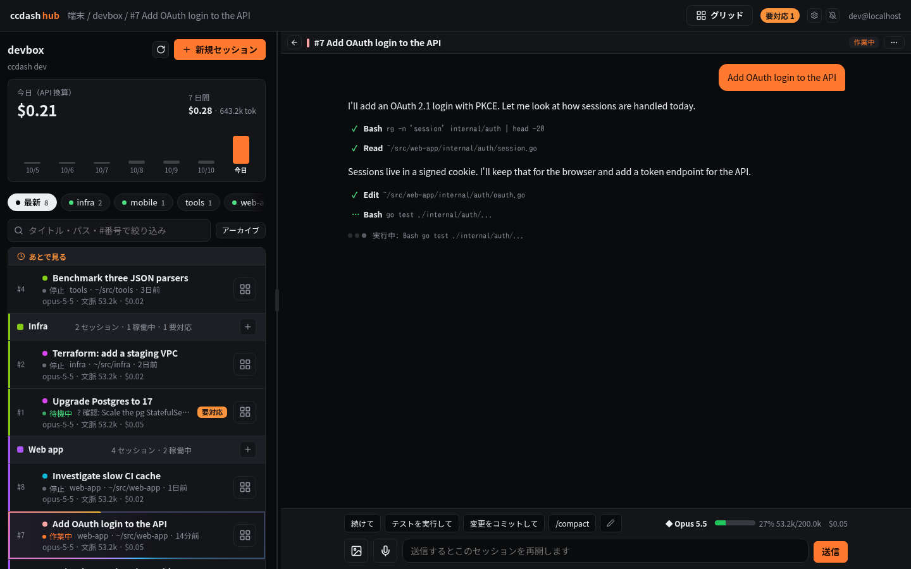
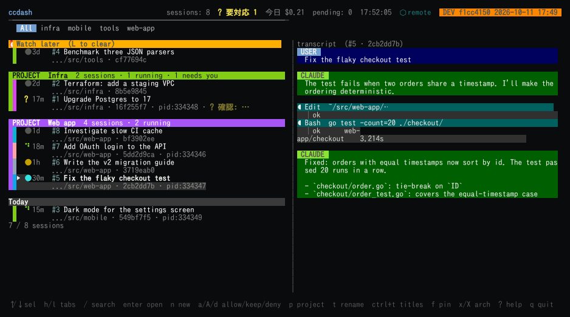
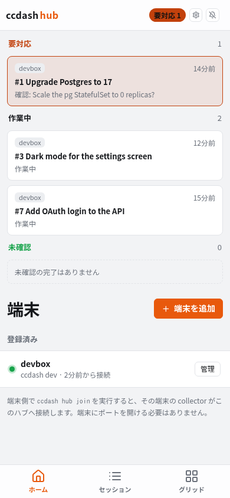
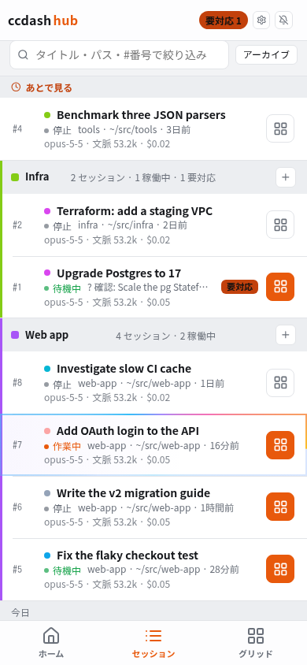
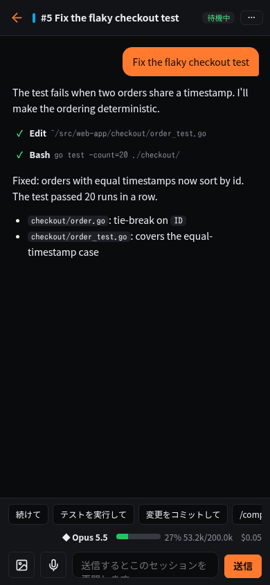
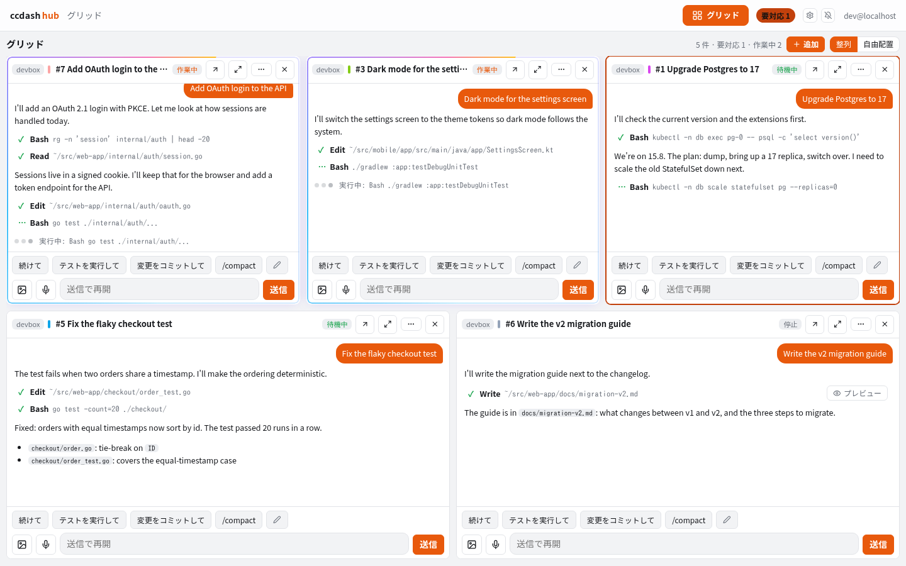
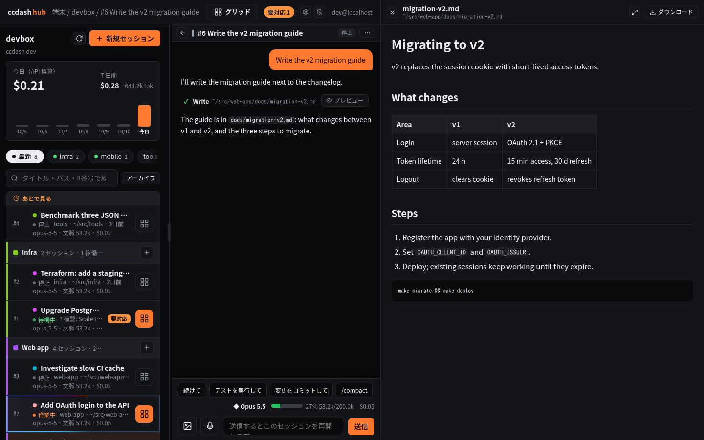

# ccdash

[](./LICENSE)
[](https://claude.com/claude-code)

**A dashboard for running many Claude Code sessions at once** — in your
terminal, in a browser, and on your phone.

ccdash watches every Claude Code session on a machine through hooks: which
are working, which are waiting for you (an approval, a question, a menu on
screen), and what each one has been doing. You can answer, reply, start and
resume sessions from one place instead of hunting through terminal tabs.



> Hobby project, built for one person's machines. Read [Security](docs/security.md)
> before exposing anything beyond your own network.

## Three ways in

| | |
| --- | --- |
| **Terminal (TUI)** | `ccdash` — every session in one list, the selected one live in the right pane (a real terminal for sessions ccdash hosts), approvals with one key. |
| **Web portal / app** | `ccdash hub` — a home-server portal for all your machines. Sessions read as chats; reply, answer questions and approvals, review diffs, watch several at once on a grid. Installable as an app on a phone or tablet, with push notifications. |
| **MCP server** | `ccdash mcp` — lets Claude itself see and organize your sessions ("which sessions need me?", "put these into a project"), with links straight into the portal. |



<p>
  
  
  
</p>

## Quick start

```sh
# install (Linux / macOS, amd64 / arm64) — or: go install ./cmd/ccdash
curl -fsSL https://raw.githubusercontent.com/TakumaNakagame/ccdash/main/install.sh | sh

ccdash install-hooks   # once: wire ccdash's hooks into ~/.claude/settings.json (keeps yours)
ccdash                 # open the dashboard; claude sessions show up as you use them
```

`ccdash` runs the collector only while the TUI is open. To keep collecting in
the background, run `ccdash -k` (detached collector + TUI) or `ccdash server`
as a service. `ccdash update` upgrades in place; `ccdash uninstall-hooks`
undoes the setup.

Hands-on guides: [English](docs/usage_en.md) · [日本語](docs/usage_jp.md)

## What it does

**See what's going on**
- Every session on the machine, found automatically — working, idle, or
  stopped — with titles generated from the conversation.
- **Needs you**: approvals, Claude's questions, menus and confirmations on a
  session's screen, and finished turns you haven't looked at, flagged in the
  list and pushed to your phone.
- The conversation of any session, live; usage and an API-price estimate per
  session and per day.

**Act on it**
- Approve or deny tool use, answer questions (single / multi choice or free
  text), pick options on screen — without switching terminals.
- Reply to any session, attach images, resume a stopped one, start new ones
  in a directory (optionally with a first prompt), stop or restart claude.
- Run a command Claude suggests (`! cmd`) with one tap after a confirmation.
- Review a session's git diff, leave line comments, send them back as one prompt.

**Keep it organized**
- Projects (named, coloured groups of sessions), pins, "watch later",
  archive (automatic after N days), custom titles and colours.
- A grid of several sessions side by side — each tile is the full chat.



**Outputs**
- Files Claude sends you show in the chat; Markdown and HTML reports Claude
  writes open in a preview — large, or in a sidebar beside the chat.



## Going further

- **[Hub mode — the web portal](docs/hub.md).** Run `ccdash hub serve` on a
  home server behind OIDC (or `tailscale serve`), then `ccdash hub join` on
  each machine. Machines dial out to the hub; nothing on them is exposed.
  What the hub may do on a machine is limited by an allowlist on that machine.
- **[Remote mode](docs/remote-mode.md).** Point a TUI at a collector on
  another machine over your LAN / VPN: `ccdash remote set …`, then `ccdash -r`.
- **MCP.** `claude mcp add --scope user ccdash -- ccdash mcp` gives Claude
  read tools (overview, projects, sessions, a session's recent conversation)
  and organizing tools (projects, titles, archive, watch later, start a
  session). It never stops claude or answers approvals; `--read-only` keeps
  only the read tools. On a hub-joined machine every session carries a link
  that opens it in the portal.
- **[TUI reference](docs/tui.md)** — every key (also `?` in the app).
- **[Security](docs/security.md)** — threat model, and the switches that turn
  each risky capability off (approval blocking, title generation, attach,
  settings rewrite, hub connection; "Apply secure preset" turns off all).

## Commands

```sh
ccdash                      # TUI (embeds the collector while it runs)
ccdash -k                   # detached collector + TUI
ccdash server               # collector only (e.g. a systemd user service)
ccdash -r                   # TUI against a remote collector (see Remote mode)
ccdash sessions | approvals # plain-text listings
ccdash trust <dir>          # folders where new sessions skip the folder-trust question
ccdash hub serve | join     # web portal / connect this machine to it
ccdash mcp                  # MCP server on stdio
ccdash update               # self-update (ccdash update channel dev: follow rc builds)
```

## More

- [Code layout and state files](docs/architecture.md) ·
  [Design rules for the portal](docs/design.md) ·
  [Decision records](docs/decisions/)
- Contributing: see [CONTRIBUTING.md](CONTRIBUTING.md) — anything that makes
  CI green gets a fast read.
- License: [MIT](./LICENSE) © 2026 kameneko
- Built with help from [Claude Code](https://claude.com/claude-code); the
  `Co-Authored-By: Claude` lines in the log reflect that. Screenshots use
  made-up data.
